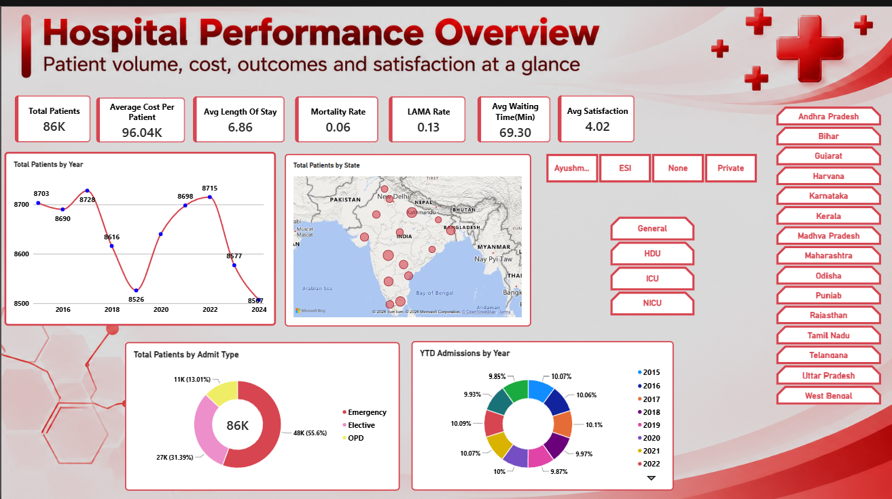
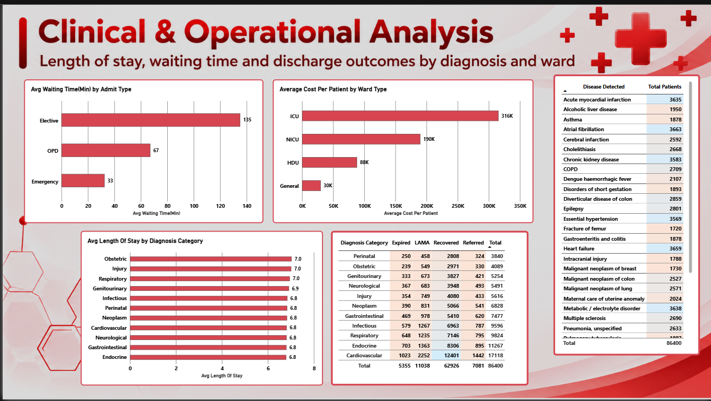
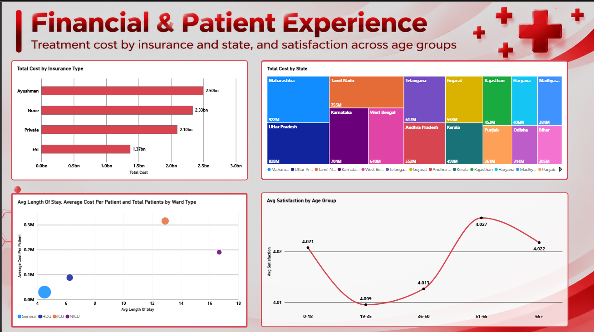
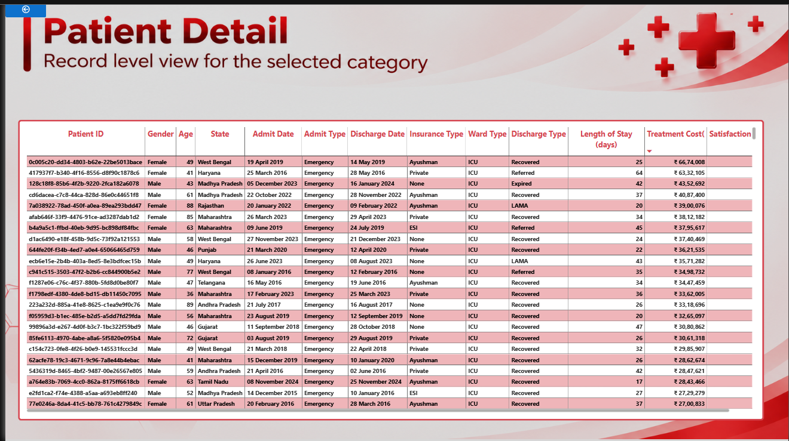

# Healthcare-Analytics-Dashboard
Interactive Power BI dashboard analyzing hospital performance, clinical outcomes, costs and patient satisfaction across Indian states (2015-2024)

# Healthcare Analytics Dashboard

An interactive Power BI dashboard that analyzes hospital performance across patient volume, clinical outcomes, treatment cost and patient satisfaction.

## Project Overview

This project analyzes **86,400 patient records (2015-2024)** across 16 Indian states. It helps hospital management understand admissions, waiting times, length of stay, discharge outcomes, insurance-wise spending and patient experience.

## Business Questions

- How many patients are admitted each year, and from which states?
- Which admit types and ward types drive cost and waiting time?
- What are the discharge outcomes (Recovered, LAMA, Referred, Expired) by diagnosis?
- Which insurance types and states account for the highest treatment cost?
- How does patient satisfaction vary across age groups?

## Dashboard Pages

### 1. Hospital Performance Overview
Patient volume, cost, outcomes and satisfaction at a glance.

- KPIs: Total Patients, Average Cost per Patient, Avg Length of Stay, Mortality Rate, LAMA Rate, Avg Waiting Time, Avg Satisfaction
- Total Patients by Year and by State
- Patients by Admit Type and YTD Admissions by Year
- Slicers: State, Insurance Type, Ward Type

### 2. Clinical & Operational Analysis
Length of stay, waiting time and discharge outcomes by diagnosis and ward.

- Avg Waiting Time by Admit Type
- Average Cost per Patient by Ward Type
- Avg Length of Stay by Diagnosis Category
- Discharge outcomes matrix and patients by disease

### 3. Financial & Patient Experience
Treatment cost by insurance and state, and satisfaction across age groups.

- Total Cost by Insurance Type and by State
- Length of Stay vs Cost by Ward Type
- Avg Satisfaction by Age Group

### 4. Patient Detail
Record-level patient table that responds to the State, Insurance Type and Ward Type slicers, which are synced across pages.

## Key Insights

- Emergency admissions make up about 56% of all patients.
- Elective admissions have the longest average waiting time (135 min), while Emergency has the shortest (33 min).
- ICU has the highest average cost per patient (about 316K), followed by NICU and HDU.
- Cardiovascular is the largest diagnosis category by patient count.
- Ayushman has the highest total treatment cost among insurance types.
- Maharashtra has the highest total treatment cost among states.
- Satisfaction is stable across age groups (about 4.0 to 4.03).

## Tools and Techniques

- - **Power BI Desktop**: dashboard design, interactivity, synced slicers, page navigation
- **Power Query**: data cleaning and transformation
- **DAX**: measures such as Total Patients, Avg Cost per Patient, Mortality Rate and LAMA Rate
- **Excel**: source dataset

## How to Use

1. Download `Healthcare_Analytics_Dashboard.pbix` from the `dashboard` folder.
2. Open it in Power BI Desktop.
3. If prompted, point the data source to `data/Healthcare_Dataset.xlsx`.

## Author
Trisham Gautam

GitHub: [trisham2794-Analyst](https://github.com/trisham2794-Analyst)
